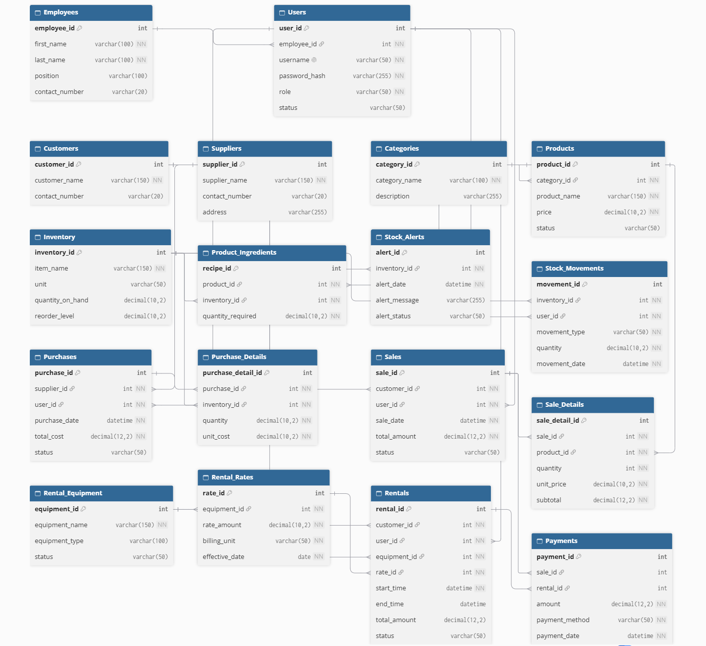

# Creamy Cup

## Sales and Inventory Management System

Creamy Cup is a web-based Sales and Inventory Management System designed to manage products, suppliers, categories, employees, customers, sales transactions, purchases, inventory, rentals, and analytical reports.

The system uses a MySQL database, a Node.js and Express.js backend (RESTful architecture), and an HTML, CSS, and Vanilla JavaScript frontend.

---

## Group Members

1. Torres, Charles Daniel L.
2. Villanueva, Raymond Jay
3. Viliran, Kaci Miel L.
4. Rano, Jonard P.
5. Tuso, Isaias James
6. Tangeres, Jade Mark N.

---

## Scope and Features

### 1. Core and Access Management

- User authentication and secure session storage.
- Manage employee accounts and link them to user credentials.
- Manage customer master records.

### 2. Master Data Management

- Full CRUD for suppliers (contact details, addresses).
- Full CRUD for product categories.
- Full CRUD for menu items and products with category associations.
- Full CRUD for employees and organizational roles.
- Full CRUD for registered customers.

### 3. Transactions and Payments (Transactions MVC)

- **Sales Transactions:** Record, view, update, and cancel customer sales with automatic payment record creation (`payments` table).
- **Rental Logs:** View comprehensive real-time rental history and equipment status logs.
- **Stock Movements Log:** Track and audit inventory intake (`IN`) and usage/waste (`OUT`).
- **Purchase History:** Record and manage restock transactions from suppliers with cost calculations.
- Integrated tabbed management UI in `transactions.html`.

### 4. Inventory and Unique Features

- Real-time inventory tracking (quantity on hand, units, reorder levels).
- Manage recipe ingredients per product (`product_ingredients`).
- Automated low-stock detection (`quantity_on_hand <= reorder_level`).
- Automated stock alerts generation and logging.

### 5. Purchases, Reports and Analytics

- Daily sales aggregation reports (transaction count and daily revenue).
- Supplier purchase reports with supplier details.
- Equipment rental reports with customer and equipment joins.
- Payments audit reports across sales and rentals.
- Stock health, low-stock, and alert monitoring reports.

### 6. Audit and Rentals

- Rental equipment inventory tracking and availability toggles (`Available` ↔ `Rented`).
- Configurable rental rate matrices with billing units (per hour, per day).
- Full rental transaction workflow (Active rentals, completion, and linked payments).

---

## Technologies Used

- **Database:** MySQL
- **Database Driver:** MySQL2 (Connection Pool)
- **Backend:** Node.js, Express.js
- **Frontend:** Semantic HTML5, Modern CSS3, Vanilla JavaScript (ES6+ Fetch API)
- **Architecture:** Model-View-Controller (MVC) & RESTful JSON APIs
- **Environment Management:** Dotenv

---

## Member Responsibilities

| Member                        | GitHub Username  | Tables Owned / Integrated                                                      | Endpoints & Screens                                                                                               | Assigned Join Report                                                                          | Feature Role                |
| :---------------------------- | :--------------- | :----------------------------------------------------------------------------- | :---------------------------------------------------------------------------------------------------------------- | :-------------------------------------------------------------------------------------------- | :-------------------------- |
| **Torres, Charles Daniel L.** | `@ttsonic8`      | `users`, `employees`, `customers`                                              | `/api/auth`, `/api/master-data/customers`, `login.html`, `masterdata.html`                                        | `GET /api/users/report`<br>_(users LEFT JOIN employees)_                                      | Core & Access Management    |
| **Villanueva, Raymond Jay**   | `@oxcymoni`      | `categories`, `products`, `suppliers`                                          | `/api/master-data/categories`, `/api/master-data/products`, `/api/master-data/suppliers`, `masterdata.html`       | `GET /api/products/report`<br>_(products INNER JOIN categories INNER JOIN suppliers)_         | Master Data Management      |
| **Viliran, Kaci Miel L.**     | `@kakkaakk`      | `sales`, `sale_details`, `payments`<br>_(with `stock_movements`, `purchases`)_ | `/api/transactions/*`<br>(`/sales`, `/rental-logs`, `/stock-movements`, `/purchase-history`), `transactions.html` | `GET /api/sales/report`<br>_(sales INNER JOIN payments)_                                      | Transactions & Payments     |
| **Rano, Jonard P.**           | `@jonardrano916` | `inventory`, `product_ingredients`, `stock_alerts`                             | `/api/inventory`, `/api/product-ingredients`, `/api/low-stock`, `/api/stock-alerts`, `inventory.html`             | `GET /api/inventory/report`<br>_(inventory LEFT JOIN product_ingredients)_                    | Inventory & Unique Features |
| **Tuso, Isaias James**        | `@Zerox`         | `purchases`, `purchase_details`, `stock_alerts`                                | `/api/reports/*`<br>(`/reports/sales`, `/purchases`, `/rentals`, `/payments`), `reports.html`                     | `GET /api/purchases/report`<br>_(purchases INNER JOIN suppliers)_                             | Reports & Analytics         |
| **Tangeres, Jade Mark N.**    | `@SirJeydii`     | `rental_equipment`, `rental_rates`, `rentals`, `payments`                      | `/api/audit/equipment`, `/api/audit/rates`, `/api/audit/rentals`, `audit.html`                                    | `GET /api/audit/rentals/report`<br>_(rentals LEFT JOIN rental_equipment LEFT JOIN customers)_ | Audit & Rentals             |

---

# Setup Instructions

## Prerequisites

Before running the project, install:

- **Node.js** (v18 or higher recommended)
- **npm** (bundled with Node.js)
- **MySQL Server** (v8.0+)
- **MySQL Workbench** or any preferred database client
- **Visual Studio Code**
- **VS Code Live Server extension**

---

## 1. Clone the Repository

Open your terminal and run:

```bash
git clone https://github.com/oxcymoni/CREAMY-CUP-SALES-AND-INVENTORY-MANAGEMENT-SYSTEM.git
cd CREAMY-CUP-SALES-AND-INVENTORY-MANAGEMENT-SYSTEM
```

---

## 2. Configure the Database

1. Open MySQL Workbench and connect to your local MySQL instance.
2. Create the project database:

CREATE DATABASE CreamyCup_database;
USE CreamyCup_database;

3. Import and execute your group's database schema and seed data scripts.

---

## 3. Configure Environment Variables

Create a .env file in the project root directory:

env
DB_HOST=localhost
DB_PORT=3306
DB_USER=root
DB_PASSWORD=your_mysql_password
DB_NAME=CreamyCup_database
PORT=3000

**Security Note:** Never commit your actual `.env` file to version control.

---

## 4. Install Dependencies & Start the Backend

Install dependencies:

npm install

Start the Express API server:

node server.js

When successful, your terminal displays:
text
Server running at http://localhost:3000

Verify by navigating to http://localhost:3000/ in your browser. You should see:
text
CREAMY-CUP-SALES-AND-INVENTORY-MANAGEMENT-SYSTEM API is running

---

## 5. Launch the Frontend

1. Open the project in Visual Studio Code.
2. Right-click login.html and click _Open with Live Server_.
3. Log in with a valid account (e.g., standard admin credentials).

### Available Frontend Interfaces:

- login.html – Authentication and session routing.
- masterdata.html – Suppliers, categories, products, employees, and customers management.
- transactions.html – Sales log, rental log viewer, stock movement logging, and purchase history.
- inventory.html – Inventory items, low-stock monitors, and product ingredient recipes.
- reports.html – Daily sales analytics, purchase summaries, rental metrics, and payment reports.
- audit.html – Rental equipment management, rate definitions, and active rental workflows.

---

# API Endpoint Directory

## 1. Core and Access Management

Base URL: /api/auth

| Method | Endpoint            | Description                                          |
| :----- | :------------------ | :--------------------------------------------------- |
| POST   | /api/auth/login     | Authenticate user credentials and start session      |
| GET    | /api/auth/users     | Retrieve all user accounts with linked employee data |
| GET    | /api/auth/users/:id | Retrieve single user record by ID                    |
| POST   | /api/auth/users     | Create a new user account                            |
| PUT    | /api/auth/users/:id | Update user details (username, role, status)         |
| DELETE | /api/auth/users/:id | Delete user account                                  |

---

## 2. Master Data Management

Base URL: /api/master-data

### Suppliers

| Method | Endpoint                       | Description                 |
| :----- | :----------------------------- | :-------------------------- |
| GET    | /api/master-data/suppliers     | Retrieve all suppliers      |
| GET    | /api/master-data/suppliers/:id | Retrieve supplier by ID     |
| POST   | /api/master-data/suppliers     | Register new supplier       |
| PUT    | /api/master-data/suppliers/:id | Update supplier information |
| DELETE | /api/master-data/suppliers/:id | Delete supplier             |

### Categories

| Method | Endpoint                        | Description                     |
| :----- | :------------------------------ | :------------------------------ |
| GET    | /api/master-data/categories     | Retrieve all product categories |
| GET    | /api/master-data/categories/:id | Retrieve category by ID         |
| POST   | /api/master-data/categories     | Create new category             |
| PUT    | /api/master-data/categories/:id | Update category details         |
| DELETE | /api/master-data/categories/:id | Delete category                 |

### Products

| Method | Endpoint                      | Description                               |
| :----- | :---------------------------- | :---------------------------------------- |
| GET    | /api/master-data/products     | Retrieve all products with category names |
| GET    | /api/master-data/products/:id | Retrieve product by ID                    |
| POST   | /api/master-data/products     | Add new product                           |
| PUT    | /api/master-data/products/:id | Update product price, category, status    |
| DELETE | /api/master-data/products/:id | Delete product                            |

### Employees

| Method | Endpoint                       | Description             |
| :----- | :----------------------------- | :---------------------- |
| GET    | /api/master-data/employees     | Retrieve all employees  |
| GET    | /api/master-data/employees/:id | Retrieve employee by ID |
| POST   | /api/master-data/employees     | Create employee record  |
| PUT    | /api/master-data/employees/:id | Update employee details |
| DELETE | /api/master-data/employees/:id | Delete employee record  |

### Customers

| Method | Endpoint                       | Description             |
| :----- | :----------------------------- | :---------------------- |
| GET    | /api/master-data/customers     | Retrieve all customers  |
| GET    | /api/master-data/customers/:id | Retrieve customer by ID |
| POST   | /api/master-data/customers     | Register new customer   |
| PUT    | /api/master-data/customers/:id | Update customer details |
| DELETE | /api/master-data/customers/:id | Delete customer record  |

---

## 3. Transactions (Transactions & Sales MVC)

Base URL: /api/transactions

### Sales Transactions

| Method | Endpoint                    | Description                                              |
| :----- | :-------------------------- | :------------------------------------------------------- |
| GET    | /api/transactions/sales     | Retrieve all sales transactions with payment method      |
| GET    | /api/transactions/sales/:id | Retrieve sale record by ID                               |
| POST   | /api/transactions/sales     | Create sale transaction and auto-generate payment record |
| PUT    | /api/transactions/sales/:id | Update sale and synchronize linked payment               |
| DELETE | /api/transactions/sales/:id | Delete sale and cascade remove linked payments           |

### Rental Logs (Read-Only Log Tab)

| Method | Endpoint                          | Description                                                 |
| :----- | :-------------------------------- | :---------------------------------------------------------- |
| GET    | /api/transactions/rental-logs     | Retrieve rental transaction log with equipment and customer |
| GET    | /api/transactions/rental-logs/:id | Retrieve specific rental log entry by ID                    |

### Stock Movements

| Method | Endpoint                              | Description                                   |
| :----- | :------------------------------------ | :-------------------------------------------- |
| GET    | /api/transactions/stock-movements     | Retrieve all stock movement records (IN/OUT)  |
| GET    | /api/transactions/stock-movements/:id | Retrieve stock movement by ID                 |
| POST   | /api/transactions/stock-movements     | Record stock movement (IN intake / OUT usage) |
| PUT    | /api/transactions/stock-movements/:id | Update stock movement record                  |
| DELETE | /api/transactions/stock-movements/:id | Delete stock movement entry                   |

### Purchase History

| Method | Endpoint                               | Description                                   |
| :----- | :------------------------------------- | :-------------------------------------------- |
| GET    | /api/transactions/purchase-history     | Retrieve purchase records with supplier names |
| GET    | /api/transactions/purchase-history/:id | Retrieve purchase record by ID                |
| POST   | /api/transactions/purchase-history     | Add supplier purchase record                  |
| PUT    | /api/transactions/purchase-history/:id | Update purchase record                        |
| DELETE | /api/transactions/purchase-history/:id | Delete purchase record                        |

---

## 4. Inventory and Unique Features

Base URL: /api

### Inventory Items

| Method | Endpoint           | Description                                     |
| :----- | :----------------- | :---------------------------------------------- |
| GET    | /api/inventory     | Retrieve inventory items ordered by ID          |
| GET    | /api/inventory/:id | Retrieve inventory item by ID                   |
| POST   | /api/inventory     | Add item with unit, quantity, and reorder level |
| PUT    | /api/inventory/:id | Update inventory stock levels and details       |
| DELETE | /api/inventory/:id | Delete inventory item                           |

### Low-Stock & Stock Alerts

| Method | Endpoint          | Description                                            |
| :----- | :---------------- | :----------------------------------------------------- |
| GET    | /api/low-stock    | Retrieve items where quantity_on_hand <= reorder_level |
| GET    | /api/stock-alerts | Retrieve logged stock alert notifications              |

### Product Ingredients (Recipe Management)

| Method | Endpoint                     | Description                                              |
| :----- | :--------------------------- | :------------------------------------------------------- |
| GET    | /api/product-ingredients     | Retrieve ingredient mappings with product and item names |
| GET    | /api/product-ingredients/:id | Retrieve ingredient mapping by recipe ID                 |
| POST   | /api/product-ingredients     | Link required ingredient quantity to a product           |
| PUT    | /api/product-ingredients/:id | Update ingredient quantity or mapping                    |
| DELETE | /api/product-ingredients/:id | Remove ingredient from product recipe                    |

---

## 5. Equipment and Rentals (Audit & Rental Workflow)

Base URL: /api/audit

### Equipment

| Method | Endpoint                 | Description                              |
| :----- | :----------------------- | :--------------------------------------- |
| GET    | /api/audit/equipment     | Retrieve all rental equipment and status |
| GET    | /api/audit/equipment/:id | Retrieve equipment by ID                 |
| POST   | /api/audit/equipment     | Add rental equipment item                |
| PUT    | /api/audit/equipment/:id | Update equipment name, type, or status   |
| DELETE | /api/audit/equipment/:id | Delete rental equipment record           |

### Rental Rates

| Method | Endpoint             | Description                                         |
| :----- | :------------------- | :-------------------------------------------------- |
| GET    | /api/audit/rates     | Retrieve all configured rental rate tiers           |
| GET    | /api/audit/rates/:id | Retrieve rental rate by ID                          |
| POST   | /api/audit/rates     | Create rental rate tied to an equipment item        |
| PUT    | /api/audit/rates/:id | Update rate amount, billing unit, or effective date |
| DELETE | /api/audit/rates/:id | Delete rental rate                                  |

### Active Rentals (Audit Operational Endpoints)

| Method | Endpoint               | Description                                                 |
| :----- | :--------------------- | :---------------------------------------------------------- |
| GET    | /api/audit/rentals     | Retrieve all active and completed rentals                   |
| GET    | /api/audit/rentals/:id | Retrieve rental transaction by ID                           |
| POST   | /api/audit/rentals     | Create rental, set equipment to Rented, and log payment     |
| PUT    | /api/audit/rentals/:id | Update rental, toggle equipment status, and sync payment    |
| DELETE | /api/audit/rentals/:id | Cancel rental, return equipment to Available, clean payment |

---

## 6. Reports & Analytics

Base URL: /api

| Method | Endpoint                  | Description                                              |
| :----- | :------------------------ | :------------------------------------------------------- |
| GET    | /api/reports/sales        | Grouped daily sales transactions count and total revenue |
| GET    | /api/reports/purchases    | Purchase transactions joined with supplier data          |
| GET    | /api/reports/rentals      | Rentals report with equipment and customer data          |
| GET    | /api/reports/payments     | Consolidated payment records and payment methods         |
| GET    | /api/reports/low-stock    | Inventory items meeting low-stock threshold              |
| GET    | /api/reports/stock-alerts | History of triggered stock alert logs                    |

---

## Assigned Join Reports Reference

| Member               | Report Endpoint               | Join Type  | Target Tables                                          |
| :------------------- | :---------------------------- | :--------- | :----------------------------------------------------- |
| _Charles Torres_     | GET /api/users/report         | LEFT JOIN  | users LEFT JOIN employees                              |
| _Raymond Villanueva_ | GET /api/products/report      | INNER JOIN | products INNER JOIN categories INNER JOIN suppliers    |
| _Kaci Viliran_       | GET /api/sales/report         | INNER JOIN | sales INNER JOIN payments                              |
| _Jonard Rano_        | GET /api/inventory/report     | LEFT JOIN  | inventory LEFT JOIN product_ingredients                |
| _Isaias Tuso_        | GET /api/purchases/report     | INNER JOIN | purchases INNER JOIN suppliers                         |
| _Jade Mark Tangeres_ | GET /api/audit/rentals/report | LEFT JOIN  | rentals LEFT JOIN rental_equipment LEFT JOIN customers |

---

## Entity Relationship Diagram (ERD)



`The Creamy Cup – Sales and Inventory Management System`
